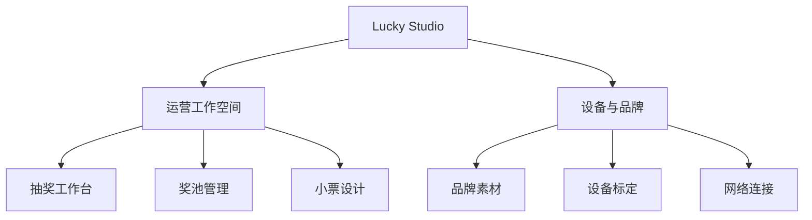
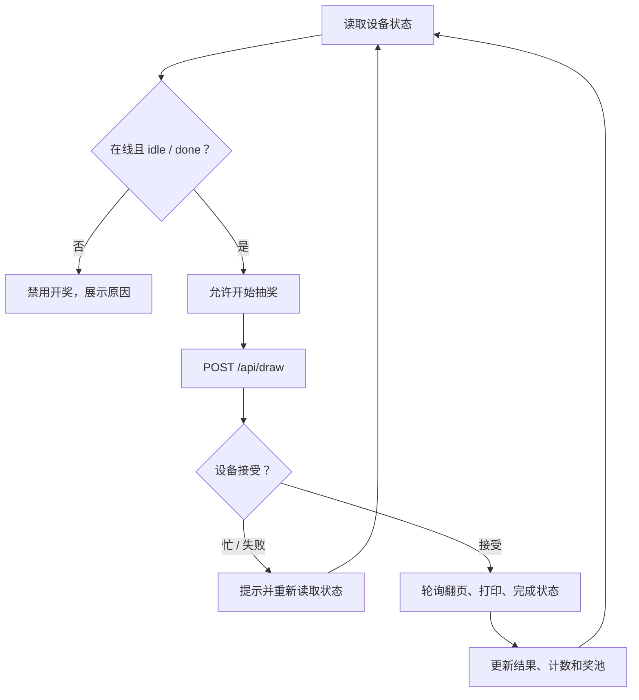

# 幸运翻页机 · UI 分析与专业应用重设计

日期：2026-10-26  
输入：`lucky-page_spiffs_contents.zip`，包含 6 个 HTML 页面及共享 `app.css`、`app.js`。  
交付形态：原生前端实现、单文件交互预览、分析与验证报告、原始备份。

## 1. 产品定位与评审结论

该产品是面向实体“幸运翻页机”的本地 Web 控制台：运营人员触发开奖、管理奖项与库存；配置人员编辑热敏小票和 Logo；安装人员调整机械行程、配置网络。

原版已经有共享设计令牌、选中导航、消息条、手机触控和小票属性抽屉。这些是有效基础。本次重点在于把六个功能页组织成完整工作台，提升桌面操作效率、状态可信度和关键编辑流程的可靠性。

重设计命名为 **Lucky Studio**，保留“幸运翻页机”中文产品标识，采用浅色工作区、深绿色导航与橙色主要操作。界面围绕现场任务展开，不添加后台未提供的营收、转化率、历史趋势或虚构设备指标。

## 2. 原 UI 的发现与对应改进

| 发现 | 源码依据 | 实际影响 | 重设计处理 |
| --- | --- | --- | --- |
| 主页面仍是上下堆叠的操作卡 | `index.html`：计数、抽奖按钮、最近结果、测试打印分散；普通页宽约 760px | 桌面难以同时核对奖池和设备状态 | 工作台集中展示计数、可用奖级、有限库存、抽奖状态、结果及设备信息 |
| 顶部六个入口同级 | 各页 `nav .tabs` | 运营任务与安装维护缺少层级 | 侧栏分运营工作空间与设备/品牌；手机使用 3 个高频入口 + 更多抽屉 |
| 主操作占据过强注意力 | 原 `#draw` 使用大面积径向渐变圆形按钮并整体旋转 | 活动感强，但状态和操作的层级不够稳定 | 翻页卡片作为视觉中心，主按钮固定在操作区；动画仅表达设备正在处理 |
| 奖池编辑存在库存串行风险 | `prizes.html`：collect 按新行号生成 level，保存按同一 level 查旧库存 | 删除前面的行后，后续奖项可能取得其他奖项的 remaining | 每行记录原等级；保存时取该原等级的最新库存，再按原协议生成连续 level |
| 奖品名称拼入 HTML 属性 | `prizes.html`：名称、副标题直接拼进 `value` | 引号和尖括号可能破坏输入框 | 奖池改用 DOM 构造与 `.value`、`.textContent` |
| 概率只在载入时显示 | 原表格输入改权重后不更新概率 | 用户难以判断待保存配置的效果 | 编辑时重算预估概率并标识“未保存”；保存后显示设备概率 |
| WiFi 有重复 ID | `wifi.html`：已连网络的 span 和手动 SSID input 都叫 `ssid` | 手动连接读取第一个节点的 `.value.trim()` 可能报错 | 已连网络改为 `connectedSsid`，手动输入保留 `ssid` |
| WiFi HTML 结尾重复 | 同页含重复 app.js、body/html 闭合片段 | 结构不规范，脚本可能重复初始化 | 归一为一个 HTML 文档、一个 body、一次共享脚本 |
| 小票存在复杂但值得保留的业务逻辑 | `receipt.html`：流式/绝对行列、bg、QR、三种版式、预览防抖、触屏轻点阈值 | 仅替换视觉容易破坏真实打印与编辑行为 | 保留原引擎、字段及防抖；重做画布/属性/动作区域的视觉与响应式 |
| 重置版式后状态可能不同步 | resetAll 后加载 flow 模板，但未同步 mode 和选择框 | 后续保存可能带着错误的版式模式 | 同步 flow、选择框、提示和花边字段显示 |
| 未保存更改缺乏清晰提醒 | 小票、奖池原页面 | 切换页面或版式可能丢稿 | 未保存标记、浏览器离开提醒；小票切换版式前提供丢弃确认 |
| Logo 阈值解释与代码相反 | `logo.html`：`gray < threshold` 为黑点，但说明称数值越小黑点越多 | 用户会反向调整 | 说明改为阈值越大，更多像素转为黑点 |
| 标定读取失败时仍可能显示默认游标 | 原 boot 在异常后仍 paintStatus | 未读取真实映射时，界面容易显得已有可信数据 | 未就绪时禁用物理操作，并将未知行程指标显示为横线 |
| 手机编辑抽屉和主导航可能重叠 | 小票属性面板固定定位且层级较高 | 打开导航后属性层会挡住链接 | 打开主导航时收起小票属性层，分清导航与编辑的层级 |

原文件内容完整保存在 `reference/original-source.zip`，没有覆盖上传的 ZIP。

## 3. 信息架构

保留六个原始页面地址，避免改变设备 HTTP 路由。桌面使用固定侧栏；手机保留“抽奖工作台 / 奖池管理 / 小票设计 / 更多”，维护能力仍可通过抽屉到达。

## 4. 视觉规范

设计基调：明亮、克制、与实体翻页设备有关联的运营工具。大部分区域用浅色和细边界，开奖区域使用深绿色与机械翻页视觉，奖项结果使用低饱和金色。

| 令牌 | 值 | 用途 |
| --- | --- | --- |
| 工作区背景 | `#F5F7F6` | 主页面 |
| 卡片 | `#FFFFFF` | 编辑、指标、状态面板 |
| 导航背景 | `#173F33` | 持续可定位的主导航 |
| 深绿 | `#194638` | 设备与正常状态主色 |
| 主操作 | `#C94E2D` | 开奖、保存；白字对比度约 4.55:1 |
| 正文 | `#20352D` | 标题、关键字段 |
| 次级正文 | `#61736A` | 标签和解释 |
| 次级元信息 | 约 `#687962` | 辅助说明，避免浅灰文字过淡 |
| 边界 | `#E5EBE7` | 卡片和分隔 |
| 成功 / 注意 / 错误 | 绿 / 褐金 / 红 | 附加文字说明，不只依赖颜色 |

页面标题约 25px，模块标题约 13～14px；表单以 12～16px 为主，手机输入为 16px，避免输入时自动缩放。元信息较小，不承载唯一关键指令。卡片圆角 11～14px，控件圆角约 7px。

字体为本地系统字体栈，数字与编号使用系统等宽字体。图标均为本地 SVG，翻页卡和小票结果摘要使用 CSS，无需图片、在线字体或 CDN。

此处只记录实际设计与局部对比度测算，不宣称通过完整无障碍认证。

## 5. 六个页面的设计

### 5.1 抽奖工作台

上方为累计开奖、今日开奖、可用奖级与剩余有限库存。后两项来自设备奖池数据；不限量奖项不纳入有限库存之和。

主区展示设备状态、机械翻页视觉和“开始抽奖”。只有状态为原协议允许的 idle / done 且连接正常时才可点击。请求失败会恢复操作状态并提示原因，接口失败不会变成模拟成功。

右侧为最近结果、设备状态与快捷入口。结果卡是摘要，完整票面在“小票设计”查看；它不承担真实二维码生成或兑奖真实性证明。长奖名仍在摘要中完整显示，翻页视觉不替代完整结果。

工作台使用设备统计和结果，不在浏览器中决定真实奖项。演示模式的抽奖仅用于体验。

### 5.2 奖池管理

基础配置与奖池表分离，桌面使用宽表，手机转为每奖级一张字段卡。页码仍为原协议的 0 基编号；限量数量与剩余库存分开显示，`-1` 表示不限量。

关键行为：

- 修改权重时显示预估概率，明确未保存；服务器保存返回后恢复设备概率。
- 删除行只改变本地草稿；保存时用原等级查询最新库存，避免行号变化关联错对象。
- 新增奖级按新数量初始化库存；降低数量时不让剩余超过总数量；更改已有数量不等同于全量补货。
- 重置全部库存单独放入操作区，并要求确认；有未保存草稿时先提示保存。
- 数值、页码、空名称和全零权重会在前端检查，服务端仍需按原协议再次校验。

仍沿用原版本 2 结构和连续 `level` 约定，没有自行给后端添加新字段。

### 5.3 小票设计

保留原画布引擎和物理打印字段：`version:3`、`mode`、`paper_cols`、`blocks`，以及 `bg`、`col`、`row`、QR 的 `size/ecc` 等。

桌面为画布 + 属性/参数侧栏。手机自动适应宽度，属性以底部抽屉显示，保存/刷新/试打在导航上方固定。打开主导航时会收起属性抽屉。

保留 58mm / 80mm、纯文字 / 画布 / 花边、文字、分隔线、二维码、Logo 和走纸能力。预览请求继续采用防抖、中断过期请求及响应序号，避免每次输入都压向设备。

针对浏览器预览，文字使用按原列宽分配的字形槽位，改善补空格对齐和中文列位显示。行列数据和打印接口不变；真实打印机的字体、纸宽和位置仍需实物验收。

### 5.4 品牌素材

将当前素材、选择文件、点阵预览、阈值和抖动处理集中呈现。保留浏览器二值化与 Floyd–Steinberg 抖动，以及 `LGO1` + MSB-first 栅格协议。

小票内的 Logo 上传保留原纸宽适配能力。本次没有把不同页面原有的位图尺寸上限擅自统一，避免在没有固件代码时改变设备约束。

### 5.5 设备标定

突出当前页、基础值、偏移和实际值；微调偏移与物理点动明确分区。保留偏移钳位、逐页点动、跳页、清零与高级基础映射。

读取真实映射/偏移前，操作保持禁用。机械安全提示及原有“逐页目视核对”说明保留。前端显示与模拟验证不能替代机械行程验收。

### 5.6 网络连接

桌面将当前连接和操作区域分栏，手机按任务顺序堆叠。保留设备热点、STA、SSID、IP/DHCP、信号、自动校时、扫描、手动连接与已保存网络。

修正重复 `ssid` ID，确保手动输入与当前网络显示各司其职。热点密码仍使用原页面的“状态显示、不回显自定义值”方式，未改变固件认证或密码存储。

## 6. 开奖交互与状态可信度

统计和库存均来源于设备 API。失联时会显示连接中断，初次尚未读取的数据使用横线。设备只提供“未报告故障”时，不将它包装成打印机完成了自检。

默认模式与演示严格分开：没有 `?demo=1` 时，`demo.js` 不接管原生 fetch；只有显式演示或根目录离线预览才使用模拟接口。真实随机与库存扣减仍由固件处理。

## 7. 响应式与可访问性

| 场景 | 策略 |
| --- | --- |
| 桌面 | 固定深色侧栏、浅色宽内容区、工作台主辅两列、编辑器画布与属性并排 |
| 中等屏幕 | 工作台辅助卡片重排，宽表允许局部滚动，编辑器可转单列 |
| ≤760px | 底部主导航 + 更多抽屉；指标 2 列；奖池转字段卡；小票使用属性抽屉 |

实现了页面定位、键盘焦点、导航抽屉焦点约束与 Escape、控件标签、消息状态区、画布元素的键盘选择、减少动画偏好，以及手机输入与触控尺寸调整。真实辅助技术与旧版 WebView 兼容性未作全面认证。

## 8. 实现与接口

| 文件 | 职责 |
| --- | --- |
| `app.css` | 全站令牌、应用骨架、组件、六页样式及响应式 |
| `app.js` | 导航、提示、接口辅助、连接反馈、键盘与字段标签 |
| `workspace.js` | 新的抽奖工作台 |
| `prizes.js` | 奖池草稿、概率、库存关联及保存 |
| `demo.js` | 显式模拟设备，包含开奖、模板、Logo、网络与标定 |
| `page-enhancements.js` | 原页面的定向增强，包含未保存提示、删除反馈和标定可用状态 |
| 六个 HTML | 保留原页面入口和重要原业务引擎 |

使用原接口组：

| 职责 | 路由 |
| --- | --- |
| 开奖 | `/api/lottery/status`、`/api/draw` |
| 奖池 | `/api/prizes`、`/api/prizes/reset-stock`、`/api/pages` |
| 小票 | `/api/receipt/template`、`/api/receipt/template/preview`、`/api/receipt/template/reset`、`/api/receipt/params` |
| 打印 / 时间 | `/api/printer/test`、`/api/time` |
| 位图 | `/api/logo`、`/api/logo/raw` |
| 标定 | `/api/adjust`、`/api/adjust/reset`、`/api/page/goto`、`/api/page-mapping` |
| 网络 | `/api/wifi`、`/api/wifi/ap`、`/api/wifi/ip`、`/api/wifi/scan`、`/api/wifi/disconnect`、`/api/wifi/reconnect` |

本次没有新增固件接口，没有引入框架或构建运行时。服务端的鉴权、参数校验、真实随机、并发写入和机械控制不在本次前端输入中。

## 9. 交付与上线

评审使用根目录 `preview.html`；设备集成仅使用 `spiffs_contents/`。原始代码备份和新源码分开。

当前版本已通过语法、静态结构、模拟协议与关键浏览器交互检查。真实设备仍需验收路由白名单、分区空间、API 兼容性、库存、纸面输出、网络变更和机械行程，详见 `validation.md`。
